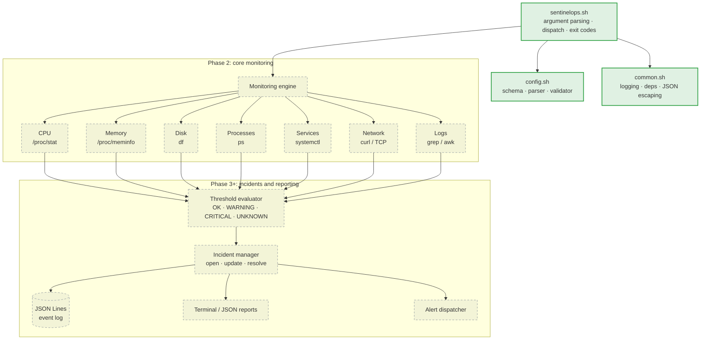

<div align="center">

# 🛡️ SentinelOps

**A Linux monitoring and incident response toolkit, written in pure Bash.**

Collects health data straight from the kernel and standard GNU/Linux tools,
classifies it as `OK` / `WARNING` / `CRITICAL` / `UNKNOWN`, and is being built
to track incidents from detection to recovery, with no agents, daemons or frameworks.


[Highlights](#-highlights) ·
[Demo](#-demo) ·
[Architecture](#-architecture) ·
[Design decisions](#-design-decisions) ·
[Testing](#-testing) ·
[Roadmap](#-roadmap)

</div>

---

> [!NOTE]
> **Project status: Phase 1 (foundation) complete.** The CLI, the hardened
> configuration loader, logging, dependency detection and a 121-test suite
> are done. The monitoring modules (CPU, memory, disk, …) come next, in Phase 2.
> Until then `check` reports every module as `UNKNOWN`, on purpose: see
> [why](#1-a-missing-measurement-is-unknown-never-ok).

## 💡 Why SentinelOps?

On-call engineers still SSH into boxes and run `top`, `free`, `df`, `ps` and
`journalctl` by hand. That's slow, inconsistent and leaves no record.
Enterprise observability stacks solve this, but they hide the mechanics.

SentinelOps does the same core job **from first principles**: it reads
`/proc`, calls standard utilities, evaluates thresholds and records structured
events, in code small enough to read in an afternoon. It's built the way
production tooling should be built: validated input, predictable exit codes,
explicit failure handling and a test suite that simulates failures safely.

## ✨ Highlights

| | |
|---|---|
| 🔒 **Config is data, never code** | The config file is parsed line by line against a strict schema. It is never `source`d or `eval`ed, so `CPU_WARNING=$(rm -rf ~)` is just a string that fails validation. A test proves nothing gets executed. |
| ❓ **Honest health reporting** | A check that couldn't measure reports `UNKNOWN`, never `OK`. Disabling every module doesn't produce a green result either. |
| 🧾 **Every config error at once** | Validation collects *all* problems with `file:line` locations, in plain text or JSON, instead of failing on the first one. |
| 🚦 **Scriptable CLI** | Logs go to stderr, results to stdout. Exit codes are documented (`0/1/2/3`), unknown options are rejected and never ignored, and `--json` output is machine-readable. |
| 🧩 **Graceful degradation** | Missing optional tools (`curl`, `systemctl`, `timeout`) are detected at runtime. It even spots WSL2's "systemctl installed but systemd not running" case. |
| 🧪 **Tested like real software** | 121 automated tests, hermetic temp directories, simulated missing tools via a restricted `PATH`, and the suite was mutation-checked (deliberately injected bugs are caught). |
| 🐧 **Least privilege** | Runs as a regular user. Never deletes files, kills processes or touches firewall rules. |

## 🎬 Demo

**Catching configuration mistakes**, all of them, with line numbers:

```console
$ cat broken.conf
CPU_WARNING=95
ENABLE_DISK=yes
MONITORED_SERVICES=ssh;reboot
CPU_WARNNG=70

$ ./sentinelops.sh validate-config --config broken.conf
2026-10-22T23:31:10Z [ERROR] sentinelops: config: broken.conf:4: unknown key 'CPU_WARNNG'
2026-10-22T23:31:10Z [ERROR] sentinelops: config: broken.conf:2: ENABLE_DISK must be 'true' or 'false', got 'yes'
2026-10-22T23:31:10Z [ERROR] sentinelops: config: broken.conf:3: MONITORED_SERVICES item 'ssh;reboot' contains invalid characters (allowed: letters, digits, . _ @ : + -; must start with a letter or digit)
2026-10-22T23:31:10Z [ERROR] sentinelops: config: CPU_WARNING (95) must be lower than CPU_CRITICAL (90)
Configuration invalid: broken.conf (4 error(s))

$ echo $?
2
```

**The same result as JSON**, ready for CI pipelines or other tools:

```console
$ ./sentinelops.sh --json validate-config --config broken.conf 2>/dev/null | python3 -m json.tool
{
    "valid": false,
    "config_file": "broken.conf",
    "errors": [
        "broken.conf:4: unknown key 'CPU_WARNNG'",
        "broken.conf:2: ENABLE_DISK must be 'true' or 'false', got 'yes'",
        ...
    ],
    "warnings": []
}
```

**Dependency detection:**

```console
$ ./sentinelops.sh deps
Bash: 5.3.9(1)-release

Required:
  awk        found    /usr/bin/awk
  grep       found    /usr/bin/grep
  sed        found    /usr/bin/sed
  df         found    /usr/bin/df
  ps         found    /usr/bin/ps

Optional:
  curl       found    /usr/bin/curl
  systemctl  found    /usr/bin/systemctl
  timeout    found    /usr/bin/timeout
```

## 🏗️ Architecture



<sub>Solid green: implemented. Dashed grey: planned.</sub>

Each monitoring module will be independent: one failing check never stops
the others. **Collection, evaluation, incident tracking and reporting are
kept strictly separate** so that each can be tested on its own. The config
loader already follows this rule: it only *collects* errors, and the CLI
decides whether to print them as log lines or as JSON.

## 🧠 Design decisions

### 1. A missing measurement is `UNKNOWN`, never `OK`
The most dangerous bug a monitor can have is a silent false "all clear".
A failed command, a missing tool or an unreadable file is **absence of
evidence**, so it's reported as `UNKNOWN` and the run exits `3`. That's why
`check` currently reports `UNKNOWN` for every module: nothing measures yet,
so claiming health would be a lie.

### 2. Configuration is parsed, not executed
`source config.conf` is the common Bash shortcut, and it means anyone who can
edit the config can run arbitrary code as whoever runs the monitor (often via
cron). SentinelOps reads the file with `while IFS= read -r`, matches each line
against a regex, rejects unknown or duplicate keys and validates each value
against its type. Some of the edge cases it handles:

| Input | Why it matters |
|---|---|
| `CPU_WARNING=080` | Rejected. Bash arithmetic treats leading zeros as **octal**, so `08` is an error. |
| `CPU_WARNING=99999999999999999999` | Rejected by length *before* arithmetic, so it can't overflow 64-bit integers. |
| `MONITORED_PROCESSES=-9` | Rejected. List items must start with a letter or digit, so they can never be read as a **command-line option** when passed to tools later. |
| `--config /dev/zero` | Rejected. Only regular files are read, so the tool can't hang on a device or FIFO. |
| CRLF line endings | Accepted. Files edited on the Windows side of WSL just work. |
| `CPU_WARNING=80 # note` | Rejected with a clear message. There are no inline comments, so nothing is ambiguous. |

### 3. No `set -e`, deliberately
`errexit` is silently disabled inside functions called from `if`, `&&`, `||`
and command substitutions, which makes it unreliable as error handling. It
would also let *one* failed check abort the *whole* monitoring run. SentinelOps
uses `set -uo pipefail` and handles errors explicitly. The libraries set no
shell options at all, because options leak into whatever script sources them
(and a test checks this).

### 4. stdout is for results, stderr is for diagnostics
So `./sentinelops.sh --json validate-config | jq` always gets clean JSON, and
cron mail or a redirect can separate the two streams. Log lines carry UTC
ISO-8601 timestamps, generated with Bash's built-in `printf '%(…)T'` (no fork
of `date`), and colour appears only when stderr is a TTY and
[`NO_COLOR`](https://no-color.org) is unset.

### 5. Don't trust `systemctl` being installed
On WSL2 (and in containers), `systemctl` often exists while systemd isn't
PID 1. SentinelOps checks `/run/systemd/system`, the same test `sd_booted(3)`
uses, so service checks can report `UNKNOWN` instead of a misleading
"failed" or "inactive".

## 🚀 Quick start

```bash
git clone https://github.com/sidvw1808/sentinelops.git
cd sentinelops
cp config/sentinelops.conf.example config/sentinelops.conf
./sentinelops.sh validate-config
./sentinelops.sh deps
./sentinelops.sh check
```

**Requirements:** Bash 4.4+, GNU coreutils, `awk`, `grep`, `sed`, `procps`.
Optional: `curl`, `systemctl`, `timeout`. For development: `shellcheck`,
`python3` or `jq`. Full guide for Ubuntu and WSL2:
[docs/INSTALLATION.md](docs/INSTALLATION.md).

## 📖 Usage

```text
sentinelops.sh [OPTIONS] COMMAND [OPTIONS]
```

| Command | Description |
|---|---|
| `check` | Run all enabled modules |
| `check --module NAME` | Run one module: `cpu` `memory` `disk` `processes` `services` `network` `logs` |
| `validate-config` | Validate the configuration and list every problem |
| `deps` | Show required/optional tool availability |
| `version` | Print the version |
| `help` | Show usage |

| Option | Description |
|---|---|
| `-c, --config PATH` | Configuration file (also `--config=PATH`) |
| `-m, --module NAME` | With `check`: run only this module |
| `--json` | JSON output (`version`, `validate-config`) |
| `-v, --verbose` / `-q, --quiet` | Show debug messages / errors only |

<details>
<summary><b>Exit codes, config lookup and environment variables</b></summary>

**Exit codes**

| Code | Meaning |
|---|---|
| `0` | Success, no problems found |
| `1` | Success, but a `WARNING` or `CRITICAL` condition was found |
| `2` | Invalid arguments or configuration |
| `3` | Monitoring failed, or required data/tools were unavailable |

If any module in a run is `UNKNOWN`, the run exits `3`, because overall health
can't be confirmed.

**Configuration lookup** (first match wins): `--config PATH` →
`$SENTINELOPS_CONFIG` → `config/sentinelops.conf` → built-in defaults (with a
warning).

**Environment:** `SENTINELOPS_CONFIG`, `SENTINELOPS_LOG_LEVEL`
(`DEBUG`/`INFO`/`WARN`/`ERROR`), `NO_COLOR`.

</details>

### Configuration

```ini
CPU_WARNING=80
CPU_CRITICAL=90
ENABLE_NETWORK=false
LOG_DIRECTORY="./my logs"          # spaces fine; relative to the install dir
MONITORED_PROCESSES=sshd,cron
MONITORED_SERVICES=ssh.service,cron.service
```

<sub>(The trailing comment above is only for this README. Real config files don't allow inline comments.)</sub>

Every key, type, default and validation rule:
[docs/CONFIGURATION.md](docs/CONFIGURATION.md).

## 🧪 Testing

```console
$ tests/run_tests.sh
sentinelops.sh
  ok    --help exits 0
  ok    check never prints OK without a measurement
  ok    deps exits 3 when a required tool is missing
  ...
config.sh
  ok    leading zero (would be octal in Bash)
  ok    command substitution in the config is not executed
  ok    list item that looks like an option
  ...
All 3 test files passed.
```

| Suite | Tests | Covers |
|---|---:|---|
| `test_cli.sh` | 48 | Every command and option, exit codes, JSON validity, config precedence, `--module` isolation, simulated missing tools |
| `test_config.sh` | 51 | Parsing, every validation rule, injection attempts, CRLF, paths with spaces, unreadable/special files |
| `test_common.sh` | 22 | Log routing and levels, timestamps, colour detection, JSON escaping, no shell-option leakage |

**How the tests stay safe and repeatable:**

- Every test file runs in its own `mktemp -d` directory, removed on exit.
- Missing dependencies are simulated by running the CLI with a `PATH` built
  from symlinks to only selected tools, so nothing gets uninstalled.
- The developer's own environment variables and config file are isolated, so
  results don't depend on the machine.
- No root, no network, no changes to the system.

## 📁 Project structure

```text
sentinelops/
├── sentinelops.sh              # CLI entry point: parsing, dispatch, exit codes
├── scripts/
│   ├── common.sh               # logging, exit codes, dependency helpers, JSON escaping
│   └── config.sh               # config schema, parser and validator
├── config/
│   └── sentinelops.conf.example
├── tests/
│   ├── run_tests.sh            # test runner
│   ├── helpers.sh              # assertion library
│   └── test_*.sh               # test suites
└── docs/
    ├── INSTALLATION.md         # Ubuntu and WSL2 setup
    ├── CONFIGURATION.md        # full config reference
    └── SPEC.md                 # project specification
```

## 🗺️ Roadmap

| Phase | Scope | Status |
|---|---|:---:|
| 1 | **Foundation**: CLI, config validation, logging, dependency checks, tests | ✅ |
| 2 | **Core monitoring**: CPU (`/proc/stat` deltas), memory (`MemAvailable`), disk, processes, services, network, logs | 🔜 |
| 3 | **Incident management**: unique IDs, JSON Lines event log, dedup, recovery detection | ⏳ |
| 4 | **Scheduling and alerts**: cron/systemd timers, optional email/webhook, notification dedup | ⏳ |
| 5 | **Hardening**: locking, timeouts, log retention, diagnostic reports | ⏳ |
| 6 | **Docker and CI/CD**: container image, GitHub Actions running ShellCheck and tests | ⏳ |
| 7 | **Observability**: Prometheus-compatible metrics export | ⏳ |
| 8 | **Dashboard**: optional web UI on top of the Bash engine | ⏳ |

## 🔐 Security

- No root required. No file deletion, process killing or firewall changes, ever.
- The configuration is never executed, and all values are validated against a fixed schema.
- No network traffic except endpoints you explicitly configure (Phase 2+).
- Machine-specific config and secrets are excluded from Git (`config/*.conf`, `.env`).

## ⚠️ Known limitations

- Monitoring modules are not implemented yet (Phase 2).
- `--json` currently covers `version` and `validate-config`.
- Symlinked installs rely on GNU `readlink -f`.
- No protection against concurrent runs yet (Phase 5).

## 📄 License

[MIT](LICENSE) © 2026 Siddhanth Waghmare

---

<div align="center">

Built to learn how Linux monitoring really works, from `/proc` up.

</div>
